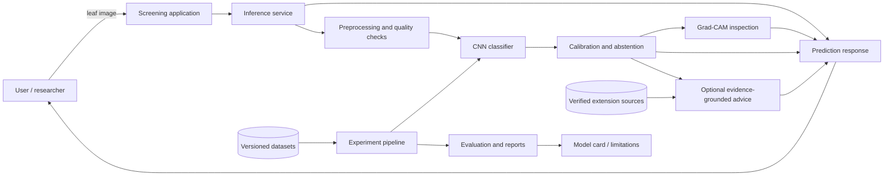
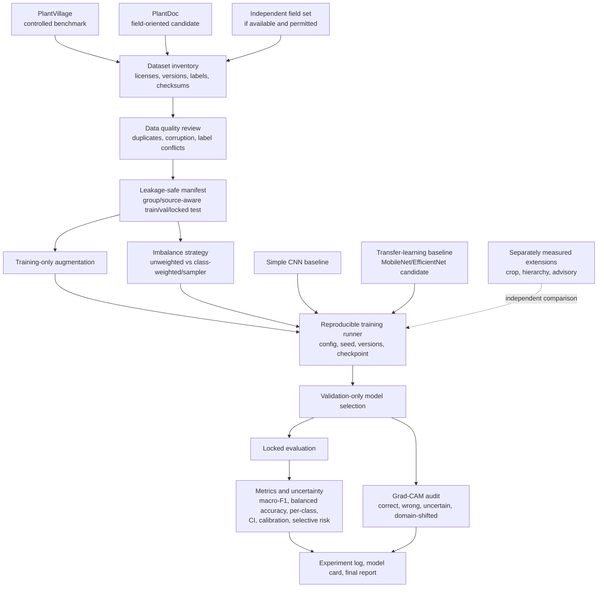
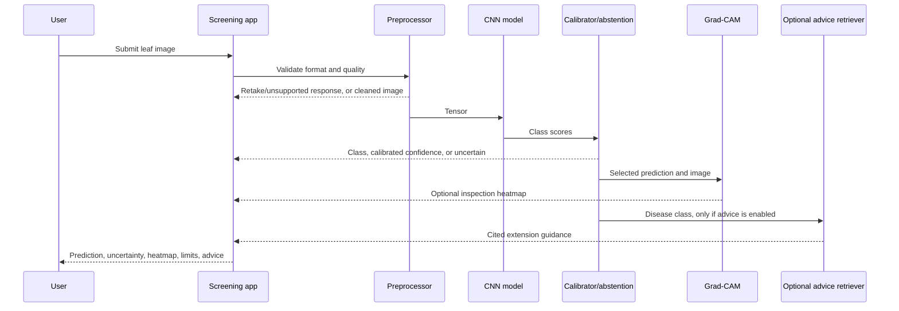

# Project architecture

This document is the implementation map for **Plant leaves disease detection using CNN**. It describes the intended system and the evidence/reproducibility controls that must surround it. Phase II data acquisition and manifest generation are implemented for PlantVillage color and PlantDoc. The CNN baseline notebook is prepared but not trained. Split integrity review found cross-partition duplicates/group overlap; resolve this before claiming independent evaluation. Model training, evaluation, and screening application remain planned.

## System context



## Training and evaluation architecture



## Runtime prediction path



## Key connections and ownership

| Area | Responsibility | Interface / artifact | Current state |
|---|---|---|---|
| Data provenance | Record source, version, license, labels, counts, and capture conditions | `data/dataset_registry.csv` and manifests | Implemented for pinned PlantVillage and PlantDoc sources |
| Data quality | Detect exact duplicates and unreadable images; review label conflicts and leakage | Manifest summary and metadata | Partial: hashes/readability; human review remains |
| Split design | Keep source/plant/group boundaries intact where possible | `data/manifests/` plus `reports/split_freeze.json` | Leakage-aware splits frozen; zero hash/group overlap in audit |
| Model training | Compare simple CNN and transfer-learning baseline | Config, seed, checkpoint, logs | Planned |
| Robustness | Test augmentation, domain mix, and imbalance handling | Controlled ablation table | Planned |
| Inference | Produce a screening prediction from a leaf image | Prediction schema | Planned |
| Uncertainty | Calibrate confidence and permit abstention | Validation-selected threshold; coverage/risk report | Planned |
| Explainability | Inspect whether attention is on leaf tissue | Grad-CAM examples and audit criteria | Planned |
| Advice | Retrieve only authoritative, region-appropriate guidance | Source-cited advisory response | Optional extension |
| Reporting | Preserve methods, failures, metrics, limitations, and licenses | Experiment log and model card | Planned |

## Prediction contract

The application should return a stable object rather than only a class string. A future implementation should include:

```text
Prediction
├── predicted_class: string | null
├── confidence: float | null
├── status: "predicted" | "uncertain" | "invalid_image"
├── supported_crop_or_scope: string
├── model_version: string
├── heatmap_uri: string | null
├── advice: string | null
├── advice_sources: list[string]
└── limitations: list[string]
```

`confidence` must not be presented as a probability guarantee until calibration is measured. An abstention response is an intended safety behavior, not a failure.

## Planned repository structure

```text
project/
├── data/
│   ├── manifests/                 # metadata only where redistribution is restricted
│   ├── splits/                    # versioned leakage-safe split files
│   └── README.md                 # provenance and license notes
├── src/
│   ├── data/                     # loaders, validation, manifest generation
│   ├── models/                   # CNN and transfer-learning constructors
│   ├── training/                 # configs, runner, checkpointing
│   ├── inference/                # preprocessing and prediction contract
│   ├── uncertainty/              # calibration and abstention
│   ├── explainability/           # Grad-CAM generation and audit helpers
│   └── advisory/                 # optional cited retrieval extension
├── scripts/                      # explicit, reproducible entry points
├── configs/                      # versioned experiment configurations
├── reports/                      # metrics, plots, ablations, failure cases
├── checkpoints/                  # ignored or separately managed model files
├── tests/                        # data, contract, preprocessing, inference tests
├── requirements.txt              # or a locked environment file
└── ARCHITECTURE.md
```

## Implementation order and decision gates

1. **Evidence and scope:** locate the missing 21-paper survey, verify citations, confirm team details, define crop/disease taxonomy.
2. **Data contract:** inventory datasets and licenses; create a deduplicated, leakage-safe manifest and locked test split.
3. **Baselines:** implement a simple CNN and a transfer-learning baseline with pinned versions, seeds, and saved configs.
4. **Robustness:** run controlled augmentation, domain-mix, and imbalance comparisons without changing multiple factors invisibly.
5. **Evaluation:** report within-domain and cross-domain performance with macro-F1, balanced accuracy, per-class metrics, confidence intervals, calibration, and selective risk.
6. **Inspection:** audit Grad-CAM on correct, incorrect, uncertain, and domain-shifted samples; preserve selection rules.
7. **Product extension:** add leaf cropping, hierarchical prediction, or advisory only after the core classifier is stable, and measure each extension independently.
8. **Release:** package the model card, limitations, licenses, reproducibility information, failure cases, and final untouched-test result.

## Non-negotiable controls

- Never split near-duplicate images or images from the same plant/source across evaluation boundaries.
- Fit preprocessing, class weights, calibration, thresholds, and model selection using training/validation only.
- Keep the final test set untouched until the protocol is frozen.
- Report field/domain-shift results separately from controlled benchmark results.
- Record failed runs and negative results; do not select only favorable examples.
- Do not invent citations, metrics, sample counts, or claims of superiority.
- Do not describe Grad-CAM as proof of causal reasoning.
- Advice must cite authoritative sources and must not provide unsupported pesticide dosage instructions.

## Phase II implementation status

Implemented: source registry and data contract; pinned downloads and extraction for PlantVillage color and PlantDoc; source metadata/license retention; Windows-safe filename mapping; hashed source manifests; leakage-aware train/validation/test manifests; split integrity audit; Kaggle small-CNN notebook. Dataset counts and exclusions are in `data/README.md`, `reports/split_freeze.json`, and `reports/data_audit.json`. No model has been trained and no performance result exists.

## Current workspace map

- [`MEMORY.md`](./MEMORY.md) is the project source-of-truth and Phase II plan.
- [`Literature-Survey-Evidence-Register.md`](./Literature-Survey-Evidence-Register.md) tracks the four source-described studies and the missing 21-paper bibliography.
- This document is the architecture and future implementation map.


