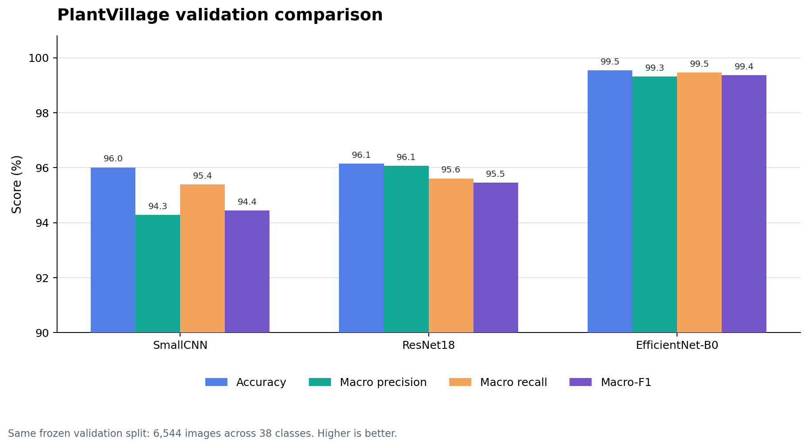
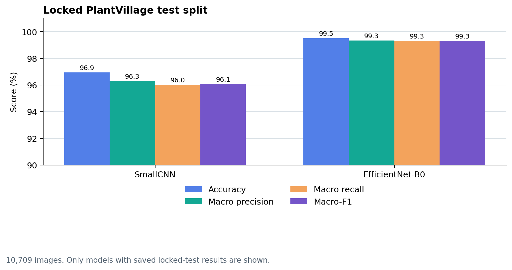
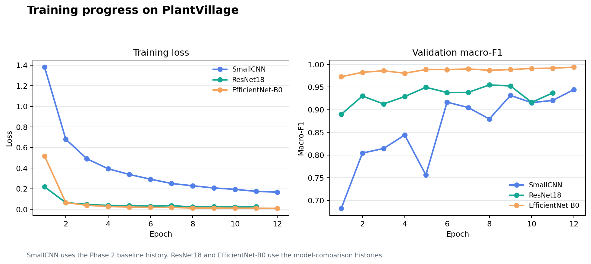

# Plant Leaf Disease Detection using CNN

This repository contains the Phase 2 research code and results. It is not the final application.

## Project question

Can a CNN identify plant leaf disease classes in PlantVillage images? We trained a simple CNN baseline. We also fine-tuned ResNet18 and EfficientNet-B0. We used the same PlantVillage training and validation splits for all models.

The Phase 1 survey record lists 21 papers. The survey led us to compare a small baseline with transfer-learning models and to report class-aware scores. One study reported 99.35% accuracy on its PlantVillage test split (Mohanty et al., 2016). Different splits and training methods mean that this published result is not a direct comparison with our results.

## Dataset and training

We use the PlantVillage dataset. It has 38 crop-disease or healthy classes across 14 crops. The frozen split has 36,762 training images, 6,544 validation images, and 10,709 test images. Each image is resized to 224 × 224 pixels.

- **SmallCNN:** trained from scratch as the baseline. The final comparison reuses its saved checkpoint.
- **ResNet18:** started from ImageNet-pretrained weights and was fine-tuned on PlantVillage.
- **EfficientNet-B0:** started from ImageNet-pretrained weights and was fine-tuned on PlantVillage.
- Training ran on two Tesla T4 GPUs in Kaggle. The comparison selected checkpoints with validation macro-F1.

The model comparison did not use the locked test split to select a model. After selection, the final test run evaluated SmallCNN and EfficientNet-B0. The available files do not include a locked-test score for ResNet18.

## Results

### Same PlantVillage validation split

| Model | Accuracy | Macro precision | Macro recall | Macro-F1 | Best epoch |
|---|---:|---:|---:|---:|---:|
| SmallCNN | 96.01% | 94.29% | 95.40% | 94.44% | 12 |
| ResNet18 | 96.15% | 96.06% | 95.61% | 95.46% | 8 |
| EfficientNet-B0 | **99.54%** | **99.31%** | **99.46%** | **99.37%** | 12 |

The validation results identify EfficientNet-B0 as the best of these three models for this PlantVillage setup.

### Locked PlantVillage test split

| Model | Images | Accuracy | Balanced accuracy | Macro precision | Macro recall | Macro-F1 |
|---|---:|---:|---:|---:|---:|---:|
| SmallCNN | 10,709 | 96.95% | 96.02% | 96.30% | 96.02% | 96.07% |
| EfficientNet-B0 | 10,709 | **99.51%** | **99.31%** | **99.33%** | **99.31%** | **99.31%** |

ResNet18 has no saved result on this locked test split. Do not infer its test score from its validation score.

The test results apply to PlantVillage images. They do not establish performance on field photographs. This repository page reports PlantVillage results only.

See [`reports/model_comparison/`](reports/model_comparison/README.md) for the comparison files and charts.

## Repository map

| Path | Purpose |
|---|---|
| `notebooks/01_Train_EfficientNet_B0.ipynb` | Train EfficientNet-B0 in Kaggle on two T4 GPUs. |
| `notebooks/02_Final_Evaluation_PlantVillage.ipynb` | Score one selected model on the locked PlantVillage test split. |
| `notebooks/03_Use_Existing_Model_for_Images.ipynb` | Predict the class for an image with a saved checkpoint. |
| `notebooks/KAGGLE_NOTEBOOKS_GUIDE.md` | Input paths and run order. |
| `src/plant_disease/models/` | SmallCNN, ResNet18, and EfficientNet-B0 definitions. |
| `src/plant_disease/` | Image loading, metrics, and evaluation code. |
| `scripts/` | Accuracy commands, training helpers, and data preparation. |
| `configs/` | Data and run settings. |
| `data/manifests/` | Frozen image paths, labels, and splits. |
| `reports/phase2_baseline/` | SmallCNN training history and held-out baseline results. |
| `reports/model_comparison/` | Three-model validation results, test comparison, and charts. |

## Run in Kaggle

1. Add the PlantVillage dataset to the Kaggle notebook.
2. Select **GPU T4 x2**.
3. Run Notebook 1 to train EfficientNet-B0. Download its result bundle from the Kaggle Output panel.
4. Choose a model using the validation comparison.
5. Run Notebook 2 once with the selected checkpoint to score the locked PlantVillage test split.
6. Use Notebook 3 to predict a supplied leaf image.

Read the [Kaggle notebook guide](notebooks/KAGGLE_NOTEBOOKS_GUIDE.md) before running. Do not run the old SmallCNN baseline notebook unless you intend to train a new baseline.

## Limit and next work

PlantVillage images have mostly controlled conditions. The high scores apply to that test set. Next, review per-class errors, test on a larger independent field-image set, inspect Grad-CAM maps, and measure confidence calibration. Do not claim field readiness from PlantVillage scores alone.

## Data and model files

Git does not contain the image datasets or trained checkpoints. Add the required dataset and checkpoint in Kaggle. Read [`data/README.md`](data/README.md) and [`configs/data_contract.yaml`](configs/data_contract.yaml) before rebuilding data. Check dataset source terms before you redistribute images.

### Additional charts

